# Employability of Engineering Students at ENSAK

This project studies how engineering students at the École Nationale des Sciences
Appliquées de Kénitra (ENSAK) perceive their employability and readiness to enter
the job market. It combines a survey analysis in R with a small text-analysis
exercise that explores response similarity.

## Research questions

The study asks:

1. Which criteria and skills are most valued by employers in the engineering
   fields represented at ENSAK?
2. What obstacles do graduates encounter when looking for work and entering the
   labor market?
3. How are perceived employability and job-market readiness related to student
   characteristics, complementary skills, curriculum relevance, and
   professional networking?

## Research hypotheses

The project formulates three main hypotheses:

| ID | Hypothesis | Survey comparisons represented in the R script |
| --- | --- | --- |
| H1 | Essential and complementary skills can influence employability. | Perceived job-market readiness (`item1`) compared with complementary skills (`item12`) and skills provided by the academic program (`item3`). |
| H2 | A university education aligned with labor-market needs improves engineering students' employability. | Perceived readiness (`item1`) compared with curriculum relevance (`item8`). |
| H3 | A well-established professional network can influence employment and career opportunities. | Perceived readiness (`item1`) compared with networking and industry-event participation (`item24`). |

## Data and project contents

| Path | Description |
| --- | --- |
| `Fichier pour le projet Excel.xlsx` (local-only) | Survey source workbook used by the quantitative analysis. It is not included because the report indicates that the source data contains respondent contact information. |
| [`script.R`](./script.R) | Survey preprocessing, descriptive summaries, assumption checks, reliability analysis, and hypothesis tests. |
| [`Saturation with Cosine Similarity/`](./Saturation%20with%20Cosine%20Similarity/) | Text-response similarity analysis. The analysis script is included; its raw workbook and screenshots are kept local because they may contain respondent data. |

The survey script renames 26 questionnaire columns as `item1` through `item26`
and analyzes demographic fields including age, gender, engineering field, and
year of study. Likert responses are recoded to integers in reverse order:
**Absolutely Disagree = 5**, **Disagree = 4**, **Neutral = 3**, **Agree = 2**,
and **Absolutely Agree = 1**.

The report's interview analysis counts **8 repeated words among 15
employability-related words (53%)**, below its stated 70% saturation threshold
(printed page 13). The separate cosine-similarity exercise works with eight
open-ended questions; its supporting R output shows a 3 × 503 term-frequency
matrix, a 3 × 3 cosine similarity matrix, and a six-observation analysis grid.
That exercise reports mean cosine similarity of **0.3333 (33.33%)** against a
separate 50% threshold. These are different analyses and should not be
interpreted as the same saturation measure or confused with the quantitative
survey sample.

## Analysis workflow

The quantitative script follows these broad steps:

1. Read the Excel survey workbook and rename questionnaire columns.
2. Convert demographic fields and recode the Likert responses.
3. Inspect age values, flag boxplot outliers, and impute flagged/missing ages
   with the mean when the flagged proportion exceeds 5%.
4. Assess age normality with a Shapiro–Wilk test and inspect skewness and
   kurtosis.
5. Calculate Cronbach's alpha for the 26 questionnaire items.
6. Summarize the demographic variables and test the study's associations using
   Wilcoxon and chi-square tests, as appropriate to the variables.

The text-analysis script assembles response text, creates a term-frequency
representation, calculates cosine similarity, and compares its average with a
50% saturation threshold. The reported mean similarity is descriptive; the
available analysis does not show an inferential test for that threshold.

## Results

### Quantitative survey analysis

The report describes a target population of **904**, a planned sample of **40**
(10% margin of error; 80% confidence), and says **44 responses** were collected.
However, the report's displayed summaries show **45 records** (30 men and 15
women; 40 first-year engineering students and 5 second-year students), while a
demographic paragraph reports 75% men and 25% women. The figures and analyses
below therefore reflect the report's presented outputs; reconcile the sample
counts and demographic percentages with the final dataset before reuse.

At a 5% significance threshold, the report presents these results:

| Comparison or hypothesis | Reported test result and interpretation |
| --- | --- |
| Age and perceived employability | Wilcoxon rank-sum test: **W = 2025, p < 2.2 × 10⁻¹⁶**; the report says perceived readiness differs by age and notes 21-year-old students as well prepared. |
| Gender and perceived employability | Chi-square: **χ² = 8.2784**, df = 4, **p = 0.0819**; no significant association reported. |
| Year of study and perceived employability | Chi-square: **χ² = 4.9538**, df = 4, **p = 0.2921**; no significant association reported. |
| H1: complementary skills (`item12`) and readiness (`item1`) | Chi-square: **χ² = 27.415**, df = 16, **p = 0.0371**; an association is reported. |
| H1: program-provided essential skills (`item3`) and readiness (`item1`) | Chi-square: **χ² = 12.442**, df = 16, **p = 0.7131**; no association is reported. The report concludes that H1 is not supported overall. |
| H2: curriculum relevance (`item8`) and readiness (`item1`) | Chi-square: **χ² = 94.54**, df = 16, **p = 3.618 × 10⁻¹³**; the report accepts H2. |
| H3: professional networking (`item24`) and readiness (`item1`) | Chi-square: **χ² = 24.532**, df = 12, **p = 0.0172**; the report accepts H3. |

For the demographic profile, the report's displayed summaries contain 40
first-year and 5 second-year students. It describes most respondents as aged
19–25, with age 20 most common. These figures should be read alongside the
sample-count and gender-percentage discrepancies noted above.

The report's Shapiro–Wilk normality result for age is **W = 0.74451,
p = 1.751 × 10⁻⁷**. It also records **skewness = 1.681705** and
**kurtosis = 7.045562**, concluding that age is not normally distributed.
Questionnaire reliability is reported as **Cronbach's raw alpha = 0.86**
(95% interval 0.79–0.91).

**Caution:** the report's chi-square output warns that the approximation may be
incorrect for some tables. Interpret the p-values cautiously, especially where
expected cell counts are small; the report does not include a correction or
follow-up exact test.

### Text-response similarity

The separate cosine-similarity analysis records a mean of approximately
**0.3333 (33.33%)**, below its **0.50 (50%)** threshold. This is a descriptive
similarity score, separate from the report's interview-word saturation estimate
of 53% and from the survey hypothesis tests.

## Figures

### Conceptual framework and study design

**Figure 1. Theoretical conceptual model.**

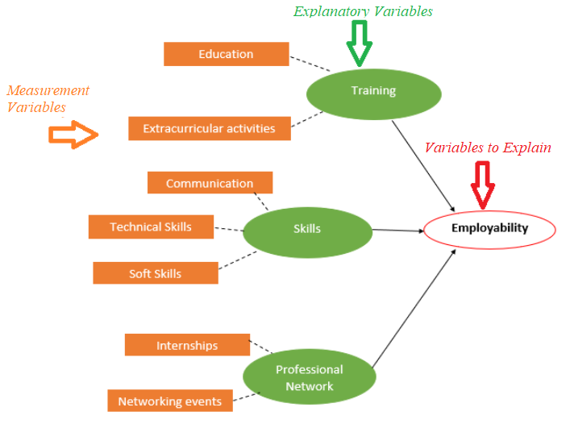

**Figure 3. Word cloud based on saturation.**

**Figure 4. Contextualized conceptual model.**

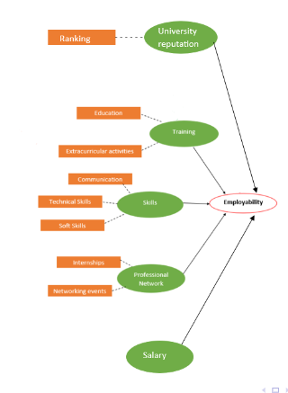

**Figure 5. Google Form used for data collection.**

**Figure 6. Sampling calculator output.** The report's
sampling narrative specifies population 904 and 80% confidence, whereas this
calculator screenshot displays 900 and 85%; both report a sample size of 40.

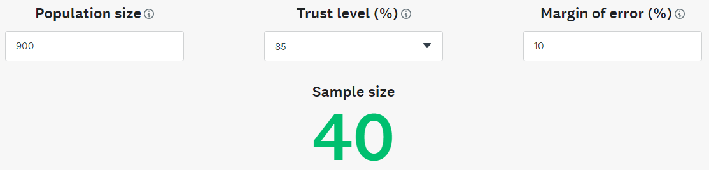

**Figure 7. Data importation with `readxl`.**

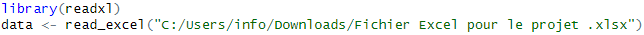

### Data preparation and reliability

**Figure 9. Item-column conversion.**

**Figure 10. Converted item headers**

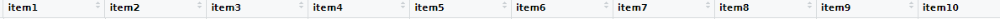

**Figure 11. Qualitative-value conversion.**

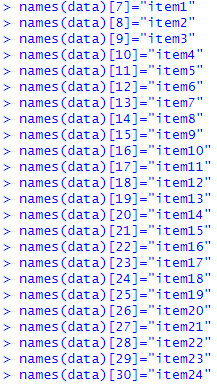

**Figure 12. Converted qualitative-value headers.**

**Figure 13. Boxplot of age before outlier treatment.**

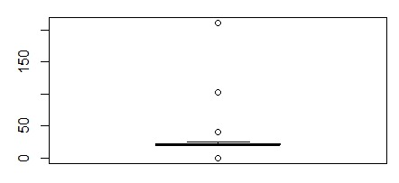

**Figure 14. Updated age boxplot.**

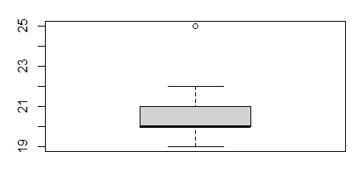

**Figure 15. Normality test output.**

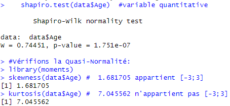

**Figure 16. Reliability analysis output.**

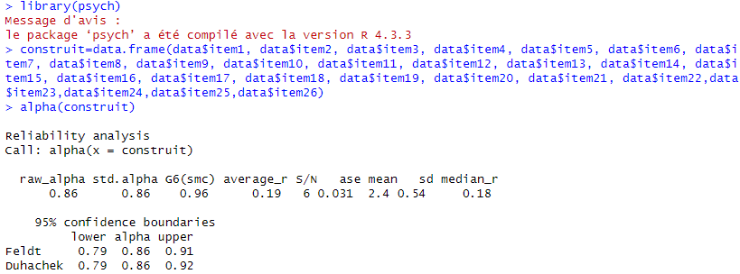

**Figure 17. Variables information.**

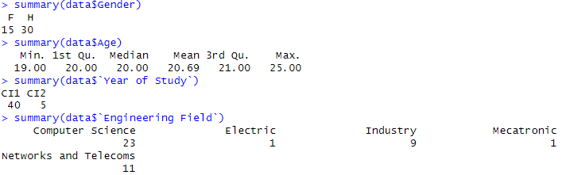

### Hypothesis tests

**Figure 18. Age and employability.**

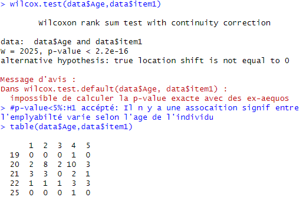

**Figure 19. Gender and employability.**

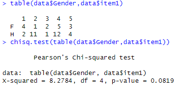

**Figure 20. Year of study and employability.**

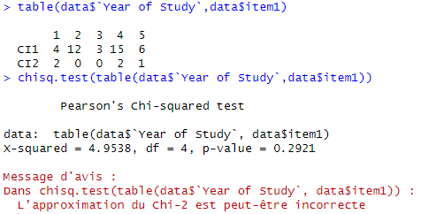

**Figure 21. Skills and employability.**

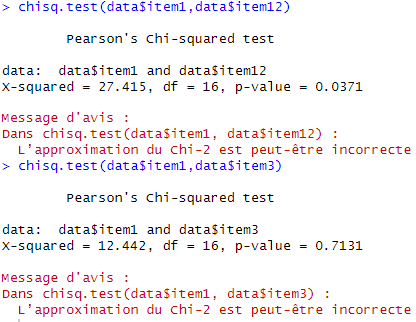

**Figure 22. University education and employability.**

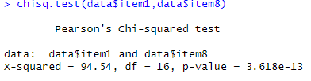

**Figure 23. Professional network and employability.**

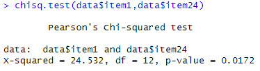

### Charts from the R script output

The following charts are from the R-output screenshot folder. They show
aggregate distributions only; screenshots containing respondent-level rows,
email addresses, or other raw output are intentionally not embedded.

**Gender distribution.** The screenshot shows 15 respondents labeled F and 30
labeled H (45 records in total).

**Engineering-field distribution.** Computer Science is the largest displayed
category, followed by Networks and Telecoms and Industry.

**Age boxplot before data cleaning.** The unusually large values in this
screenshot are shown as they appear in the original R output; they should not
be interpreted as valid respondent ages.

**Year-of-study distribution.** The chart displays 40 students in CI1 and 5 in
CI2.

**Age distribution after the script's treatment.** The supplied histogram
shows most observations at ages 20–22 and a single observation at age 25.

**Age boxplot after the script's treatment.** The screenshot still displays an
observation at age 25 beyond the upper whisker.

## Limitations and interpretation notes

- The study concerns students at one institution; results should not be
  generalized to all engineering students without additional sampling.
- The report gives three different sample counts: 40 planned, 44 responses in
  the collection narrative, and 45 rows in its displayed data summaries. Its
  gender prose (75%/25%) also conflicts with the displayed 30/15 counts.
- In its H3 discussion, the report refers to "university education," although
  the test and figure use the professional-networking variable (`item24`). The
  README labels the result by the variable actually tested.
- Some report chi-square outputs warn that the approximation may be inaccurate.
  Exact p-values are transcribed above, but their inference should be treated
  cautiously and verified with suitable tests for sparse tables.
- Age outliers are replaced by the mean when the flagged proportion exceeds 5%.
  This choice can affect the distribution and downstream tests and should be
  considered when interpreting age-related findings.
- The saturation score is an average cosine-similarity measure, not a
  significance test or proof that no new themes would emerge. The small
  text-analysis grid also limits how broadly it can be interpreted.
- Survey responses may contain personal information. Redact identifiers before
  publishing raw responses, screenshots, or derived examples.

